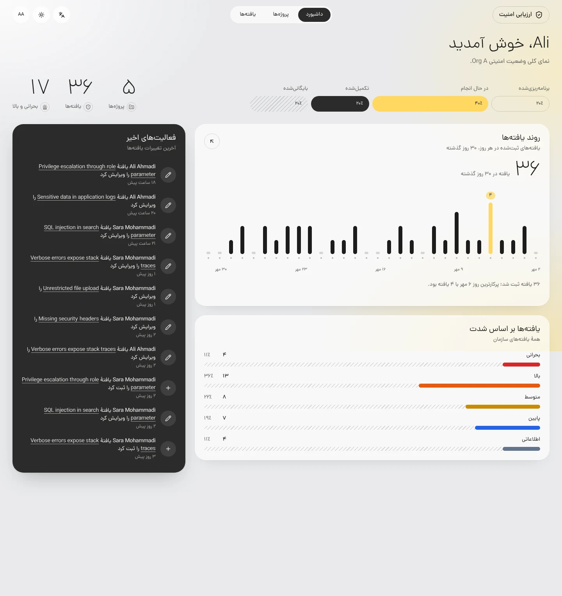
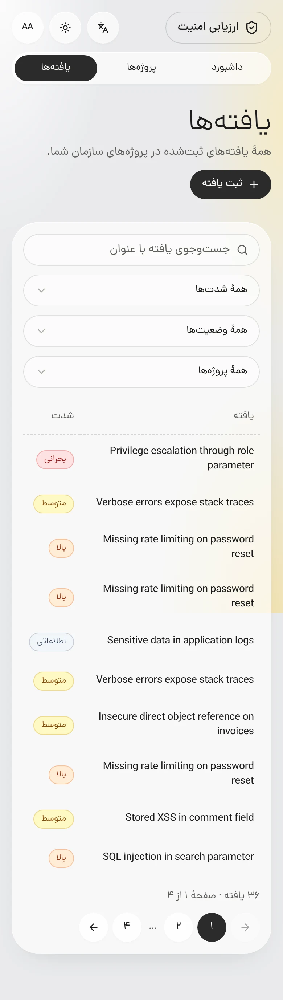

# Secure Multi-Tenant Assessment Dashboard

A dashboard where three Organizations track their security assessment Projects and the Findings those Projects produce. Users sign in with a Role (Admin, Analyst or Viewer) and see only their own Organization's data and only the actions their Role allows, enforced by the API, not just hidden in the UI.

Built for technical assessment `MB-BE-01`.

The interface is in Persian by default (right to left) and in English, with light and dark themes.

| Dashboard                                                                      | Findings on a phone                                                         |
| ------------------------------------------------------------------------------ | --------------------------------------------------------------------------- |
|  |  |

More in [`docs/screenshots/`](docs/screenshots/README.md): every main page in both languages and themes, on desktop and mobile.

## Features

| Area           | What it does                                                                                                                       |
| -------------- | ---------------------------------------------------------------------------------------------------------------------------------- |
| Authentication | Phone + one-time-code sign-in, logout, session expiry with silent refresh and a clear re-login path, protected routes              |
| Dashboard      | Project and Finding counts, Severity and Project Status breakdowns, 30-day Finding trend, latest Activities                        |
| Projects       | Search, filter, paginate; Project details with Members and Findings                                                                |
| Findings       | Search and filter; details; create and edit with validation; delete (Admin only)                                                   |
| Role-aware UI  | Actions appear according to the Permissions the API returns; the API rejects anything else                                         |
| Languages      | Persian (default, right to left, Solar Hijri dates) and English, switched in the header                                            |
| Quality        | Strict TypeScript, Storybook for shared components, unit, component and e2e tests, keyboard and screen-reader friendly, responsive |

## Tech stack

**Web:** Next.js 16 (App Router), React 19, TypeScript (strict), Tailwind CSS 4, shadcn/ui, TanStack Query, next-intl (Persian by default, and English), react-hook-form + zod, Motion, Vitest + React Testing Library + MSW, Storybook.
**API (the Mock API):** NestJS 11, TypeORM, PostgreSQL, Redis, JWT in httpOnly cookies, Swagger.
**Tooling:** pnpm workspaces, Turborepo, ESLint, Prettier, Docker Compose, GitHub Actions.

## Getting started

Requires Node.js 22, pnpm 11.25.0 and Docker (for Postgres and Redis).

```bash
pnpm install
cp docker/.env.example docker/.env
cp apps/api/.env.example apps/api/.env
docker compose -f docker/compose.yml up -d
pnpm --filter api seed
pnpm dev
```

- Web: http://localhost:3000
- API docs (Swagger): http://localhost:3001/docs

To see session expiry within a minute, set `ACCESS_TOKEN_TTL_SECONDS=60` in `apps/api/.env`. `docker compose -f docker/compose.yml down -v` removes Postgres and Redis, data included.

## Demo accounts

Every account signs in with the development code **`00000`**.

| Organization | Admin       | Analyst     | Viewer      |
| ------------ | ----------- | ----------- | ----------- |
| Org A        | 09911110001 | 09911110002 | 09911110003 |
| Org B        | 09922220001 | 09922220002 | 09922220003 |
| Org C        | 09933330001 | 09933330002 | 09933330003 |

Signing in as different Roles of the same Organization shows the Role-aware UI; switching Organization shows tenant isolation.

## Scripts

| Command                               | Purpose                        |
| ------------------------------------- | ------------------------------ |
| `pnpm dev`                            | Run API and web in watch mode  |
| `pnpm build`                          | Build all apps                 |
| `pnpm lint`                           | Lint all packages              |
| `pnpm check-types`                    | Type-check all packages        |
| `pnpm --filter frontend test`         | Web tests and stories (Vitest) |
| `pnpm --filter api test` / `test:e2e` | API unit / e2e tests (Jest)    |
| `pnpm --filter frontend storybook`    | Storybook on :6006             |

## Project structure

```
apps/api      NestJS API: auth, projects, findings, dashboard, activity, seed
apps/web      Next.js frontend
packages/     Shared ESLint and TypeScript configs
docker/       Docker Compose and its env template
docs/         Architecture, rules, roadmap, ADRs, deliverables
```

## Documentation

| Document                                          | Contents                                                       |
| ------------------------------------------------- | -------------------------------------------------------------- |
| [`docs/ARCHITECTURE.md`](docs/ARCHITECTURE.md)    | System design, security model, frontend structure              |
| [`GLOSSARY.md`](GLOSSARY.md)                      | Domain language                                                |
| [`docs/adr/`](docs/adr)                           | Architecture decision records                                  |
| [`docs/RULES.md`](docs/RULES.md)                  | Engineering rules for this repository                          |
| [`docs/ROADMAP.md`](docs/ROADMAP.md)              | Milestones and the brief's checklist                           |
| [`docs/HANDOFF.md`](docs/HANDOFF.md)              | Current state and next steps                                   |
| [`AI_USAGE.md`](AI_USAGE.md)                      | How AI assistants were used                                    |
| [`docs/components.md`](docs/components.md)        | Shared components and their props                              |
| [`docs/design-system.md`](docs/design-system.md)  | Visual language, tokens and motion                             |
| [`docs/screenshots/`](docs/screenshots/README.md) | Every main page, both languages and themes, desktop and mobile |
| [`docs/limitations.md`](docs/limitations.md)      | Known limitations and trade-offs                               |
