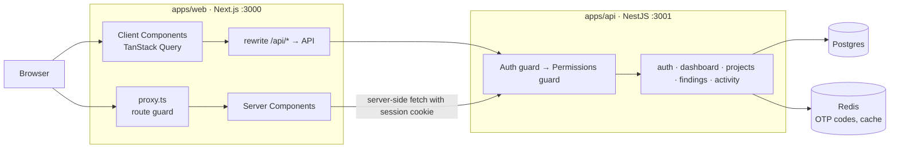
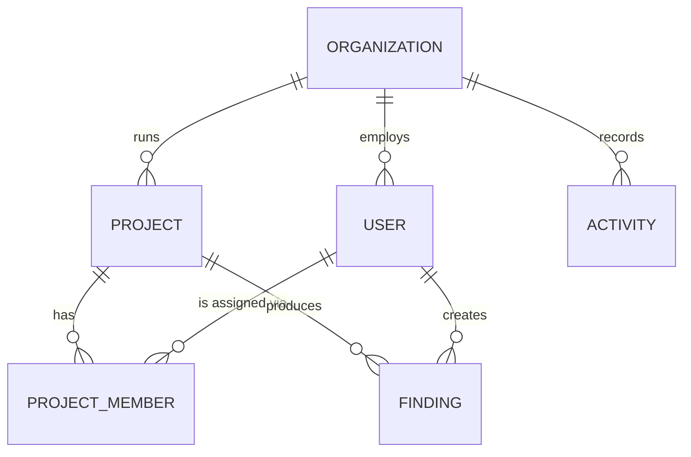
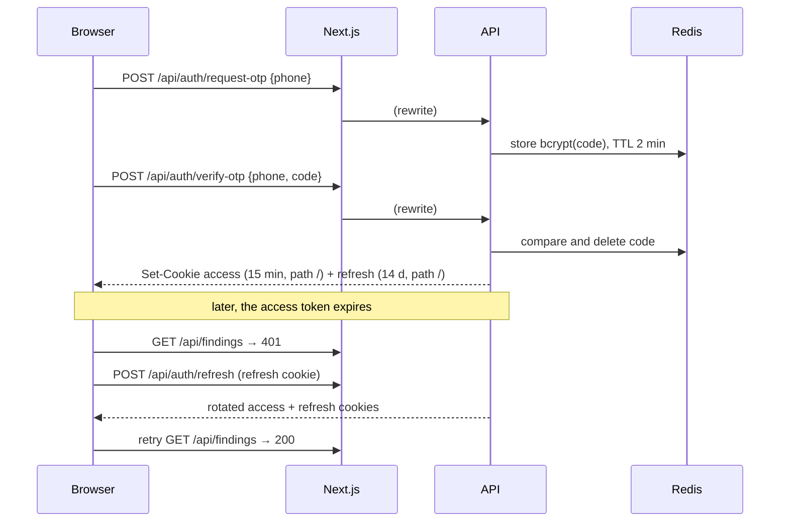
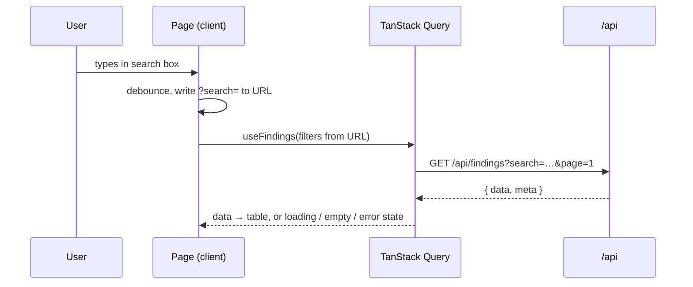

# Architecture Overview

This document describes the target design. Where the code does not match it yet, `docs/ROADMAP.md` tracks the gap. Domain terms are defined in [`GLOSSARY.md`](../GLOSSARY.md); the reasons behind key choices are in [`docs/adr/`](./adr).

## 1. System context



The browser only ever talks to the web origin. Next.js rewrites `/api/*` to the NestJS API, so session cookies are first-party and httpOnly and no CORS is involved ([ADR 0002](./adr/0002-same-origin-api-through-next-rewrites.md)). The NestJS API is also the brief's "Mock API": its data is fabricated by a seed script ([ADR 0001](./adr/0001-nestjs-backend-as-mock-api.md)).

## 2. Repository layout

```
apps/
├── api/                  # NestJS API (the Mock API)
│   ├── src/common/       # guards, decorators, filters, shared DTOs, permission map
│   ├── src/modules/      # auth, organization, project, finding, dashboard, activity
│   ├── src/seed/         # fabricated data for three Organizations
│   └── test/             # e2e: tenant isolation and Permission enforcement
└── web/                  # Next.js App Router frontend
packages/
├── eslint-config/        # shared lint rules
└── typescript-config/    # shared tsconfig bases
docker/compose.yml        # postgres, redis, api, web
docs/                     # this file, rules, roadmap, handoff, ADRs, deliverables
```

## 3. Domain model



Every tenant-owned row carries `orgId`. A User belongs to exactly one Organization and holds one Role.

| Concept        | Values                                    |
| -------------- | ----------------------------------------- |
| Role           | Admin, Analyst, Viewer                    |
| Project Status | Planned, In Progress, Completed, Archived |
| Severity       | Critical, High, Medium, Low, Info         |
| Finding Status | Open, In Review, Resolved, Risk Accepted  |

## 4. Security model

### 4.1 Authentication and Session

Users sign in with a phone number and a one-time code. In development the code is fixed (`DEV_OTP`, default `00000`) so evaluators can sign in as any seeded User.



- Both tokens are JWTs in **httpOnly, SameSite=Lax** cookies (`Secure` in production). JavaScript never sees them.
- Refresh tokens are stored as SHA-256 hashes and **rotated** on every refresh; presenting an already-rotated token revokes its whole family. Logout revokes the stored token and clears both cookies.
- OTP codes and attempt counters live in Redis. Each phone may request 3 codes per 2 minutes and make 5 wrong attempts before a 5-minute lock (`429`).
- **Session expiry in the UI:** the API client retries a `401` once after a refresh. If the refresh fails, it redirects to `/login?reason=session_expired&next=<current path>`, and the login page explains why and returns the User to where they were.
- Access-token lifetime is configurable through env so expiry can be demonstrated in a minute.

### 4.2 Route protection in the web app

1. `proxy.ts` runs before every page request ([ADR 0005](./adr/0005-session-renewal-in-the-web-proxy.md)):
   - access token present and more than 30 s from expiry → continue;
   - otherwise, with a refresh cookie → call `/api/auth/refresh`, forward the rotated cookies to the browser **and** to the page being rendered, continue;
   - renewal refused, or no session at all → redirect to `/login?next=…` (with `reason=session_expired` when a session existed).
2. The protected layout (a Server Component) loads `/auth/me` with the request's cookies. An invalid session redirects to sign-in before any page renders. `/login` itself redirects a signed-in User to `next`.
3. The User and their Permissions are passed to `SessionProvider` (`lib/session`), so client components use `useCurrentUser()`, `useCan('finding:create')` or `<Can permission="finding:create">`, and Server Components use `hasPermissions(user, 'finding:create')`.
4. In the browser, the API client renews the same way on a `401` (one shared refresh for concurrent requests) and otherwise sends the User to `/login?reason=session_expired&next=…`.

The proxy is a fast first gate; the layout check and the API are the real enforcement.

### 4.3 Authorisation

Roles map to fixed Permission sets in one place (`common/constants/permissions.constants.ts`):

| Permission                                                                       | Viewer | Analyst | Admin |
| -------------------------------------------------------------------------------- | :----: | :-----: | :---: |
| `dashboard:read`, `project:read`, `member:read`, `finding:read`, `activity:read` |   ✓    |    ✓    |   ✓   |
| `finding:create`, `finding:update`                                               |        |    ✓    |   ✓   |
| `finding:delete`                                                                 |        |         |   ✓   |

- **API:** every route declares its Permission; a guard rejects requests without it (`403`).
- **UI:** `/auth/me` returns the User's Permissions; `<Can>` and `useCan()` show or hide actions from that list. Hiding is UX only; the API is the authority.

### 4.4 Tenant isolation

`orgId` is read from the verified access token and applied to every query. A record from another Organization returns `404`, so its existence is not disclosed. Within an Organization, every User can read every Project ([ADR 0004](./adr/0004-organization-wide-project-visibility.md)).

## 5. API surface

The API serves every route under `/api`, so paths are identical through the web app's rewrite and when calling the API directly.

| Method | Path                                                     | Permission                    |
| ------ | -------------------------------------------------------- | ----------------------------- |
| POST   | `/auth/request-otp`, `/auth/verify-otp`, `/auth/refresh` | public                        |
| POST   | `/auth/logout`                                           | signed in                     |
| GET    | `/auth/me`                                               | signed in                     |
| GET    | `/dashboard/summary`, `/dashboard/trend`                 | `dashboard:read`              |
| GET    | `/dashboard/activities`                                  | `activity:read`               |
| GET    | `/projects`, `/projects/:id`                             | `project:read`                |
| GET    | `/projects/:id/members`                                  | `project:read`, `member:read` |
| GET    | `/findings`, `/findings/:id`                             | `finding:read`                |
| POST   | `/findings`                                              | `finding:create`              |
| PATCH  | `/findings/:id`                                          | `finding:update`              |
| DELETE | `/findings/:id`                                          | `finding:delete`              |

List endpoints accept `page`, `limit`, `search` and entity-specific filters, and return `{ data, meta: { page, limit, totalItems, totalPages } }`. Findings embed their Project and author, Activities their actor and target, so the UI needs no follow-up requests. `DELETE` answers `204`. The OpenAPI document at `/docs` is the contract; every route declares its response type, and the web app's types are generated from it.

## 6. Frontend

### 6.1 Routes

| Route                                  | Content                                                                                                           |
| -------------------------------------- | ----------------------------------------------------------------------------------------------------------------- |
| `/login`                               | phone step → code step; demo accounts listed in development                                                       |
| `/dashboard`                           | Project and Finding counts, Severity breakdown, Project Status breakdown, 30-day Finding trend, latest Activities |
| `/projects`                            | list with search, Project Status filter, pagination                                                               |
| `/projects/[id]`                       | details, Members, the Project's Findings                                                                          |
| `/findings`                            | list with search, Severity / Finding Status / Project filters, pagination                                         |
| `/findings/[id]`                       | details; edit and delete actions by Permission                                                                    |
| `/findings/new`, `/findings/[id]/edit` | form pages                                                                                                        |

### 6.2 Source layout

```
src/
├── app/
│   ├── (auth)/login/
│   └── (app)/            # protected layout: session check, shell, providers
│       ├── dashboard/  projects/  findings/
├── features/
│   ├── auth/  dashboard/  projects/  findings/
│   │   └── api/ components/ hooks/ schemas/
├── components/
│   ├── ui/               # shadcn primitives
│   └── shared/           # SeverityBadge, StatusBadge, DataTable, SearchInput,
│                         # FilterSelect, StatCard, BreakdownList, EmptyState, ErrorState
├── hooks/                # app-wide React hooks
├── i18n/                 # next-intl config, request config, fa/en messages, formats
└── lib/                  # api client, session, query client, utils
```

### 6.3 State ownership ([ADR 0003](./adr/0003-state-ownership-url-query-zustand.md), [ADR 0006](./adr/0006-no-client-state-library.md))

| State                       | Owner             | Example                          |
| --------------------------- | ----------------- | -------------------------------- |
| Server data                 | TanStack Query    | findings list, current User      |
| Search, filters, pagination | URL search params | `/findings?severity=HIGH&page=2` |
| Client-only UI              | its own component | sidebar (cookie), theme          |

### 6.4 Data flow for a list page



### 6.5 Languages ([ADR 0007](./adr/0007-persian-default-locale-in-a-cookie.md))

The UI speaks Persian (default, right to left) and English. `src/i18n/request.ts` reads the `NEXT_LOCALE` cookie, loads that language's messages and the shared named formats, and fixes the time zone so server and browser render the same dates. The root layout sets `<html lang dir>` from it; the header's language menu sets the cookie through a Server Action and refreshes. Components never hold UI text: Server Components call `getTranslations`, client components `useTranslations`, and dates and numbers go through the `next-intl` formatter, which gives Persian digits and the Solar Hijri calendar in Persian.

## 7. Quality

- **Testing:** Vitest + React Testing Library + MSW for the web app; Jest for the API, with e2e tests for tenant isolation and Permission enforcement. See `docs/RULES.md` §5.
- **Storybook:** every shared component has stories for its states; props are documented in `docs/components.md`.
- **CI:** GitHub Actions runs lint, typecheck, tests and build on every pull request.
- **Accessibility:** semantic HTML, full keyboard support, visible focus, labelled controls, never colour alone.

## 8. Runtime

`docker/compose.yml` runs four containers with working defaults, so `docker compose up --build` needs no configuration:

| Container  | Image                 | Notes                                                                                   |
| ---------- | --------------------- | --------------------------------------------------------------------------------------- |
| `postgres` | postgres:17           | host port 15432 for local development                                                   |
| `redis`    | redis:8               | OTP codes and attempt counters                                                          |
| `api`      | `apps/api/Dockerfile` | seeds on first start (`--if-empty`), health check on `/api/health`, runs as `node`      |
| `web`      | `apps/web/Dockerfile` | Next.js standalone server; the `/api` rewrite target (`API_URL`) is fixed at build time |

Both Dockerfiles are multi-stage: dependencies are installed and built with the pinned pnpm, and only production output reaches the runtime image. `.dockerignore` keeps `.env` files out of every image.

## 9. Decisions

| ADR                                                         | Decision                                                           |
| ----------------------------------------------------------- | ------------------------------------------------------------------ |
| [0001](./adr/0001-nestjs-backend-as-mock-api.md)            | The NestJS backend serves as the Mock API                          |
| [0002](./adr/0002-same-origin-api-through-next-rewrites.md) | The browser reaches the API through Next.js rewrites               |
| [0003](./adr/0003-state-ownership-url-query-zustand.md)     | Filters live in the URL, server data in TanStack Query             |
| [0004](./adr/0004-organization-wide-project-visibility.md)  | Every User sees every Project in their Organization                |
| [0005](./adr/0005-session-renewal-in-the-web-proxy.md)      | Sessions are renewed in the web proxy; refresh cookie is site-wide |
| [0006](./adr/0006-no-client-state-library.md)               | No client state library; UI state stays with its component         |
| [0007](./adr/0007-persian-default-locale-in-a-cookie.md)    | Persian is the default language; the choice lives in a cookie      |
